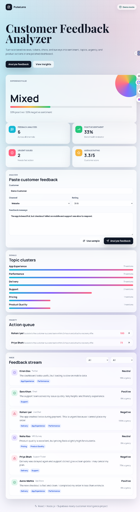

# Customer Feedback Analyzer

Concept presentation for analyzing customer feedback and turning it into structured business insights.

## Repository status

This GitHub repository currently contains this README and two presentation images only. The application source, backend, model/provider configuration, sample data, and evaluation code are not included, so the described workflow cannot be reproduced from this repository.

The linked Vercel URL returned an HTTP 200 app shell during review. That confirms the page responds, not that its analysis flows or backend are working.

## Proposed capabilities

These are intended project capabilities, not verified features in this source repository:

- Sentiment analysis for customer reviews
- Theme and trend detection
- AI-generated summaries and recommendations
- Retrieval-Augmented Generation workflow
- Interactive dashboard for exploring insights

## Why it matters

Teams often have more customer feedback than they can manually review. The concept explores ways to turn unstructured reviews into signals that can support product, support, and business decisions.

## Architecture

Proposed workflow (not verified against application source):

1. Ingest customer feedback (proposed)
2. Clean and prepare text data (proposed)
3. Classify sentiment and identify themes (proposed)
4. Retrieve relevant context (proposed)
5. Generate concise insights and recommendations (proposed)
6. Present results in a dashboard (proposed)

## Intended tech focus

Python • NLP • Generative AI • RAG • Data Analysis • Interactive Dashboards

## Live demo

[Open Customer Feedback Analyzer](https://customer-feedback-analyzer-three.vercel.app/)

## Getting started

No installation or run command is available because the app source and dependency manifests are not present. The preview URL is retained from the project listing; validate its user flows before describing it as a working demo.

## To make the project reproducible

Add the frontend and backend source, model/provider details, a safe sample dataset, dependency manifests, run instructions, and an evaluation plan. Do not claim an AI model, RAG implementation, or accuracy until the source and evaluation support those claims.

## Author

Built by [Kalyan](https://github.com/kalyan870).

If this project is useful, consider trying the demo and sharing feedback.
## Repository status and reproducibility

This repository currently contains the overview, workflow notes, and presentation images, but not the application source or install files. The architecture above is a product workflow, not a verified code diagram. The hosted demo link is retained from the original project notes; availability may change. Add the frontend/backend source, model configuration, sample data, and run instructions to make the project reproducible.
